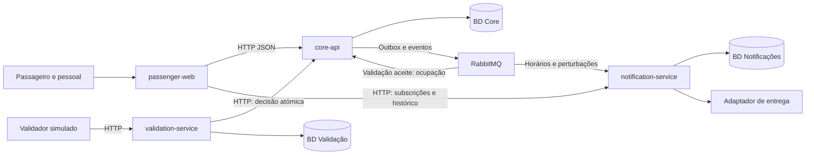

# MetroIsJustABus — Especificação de requisitos e arquitetura inicial

**Unidade curricular:** Automated Software Engineering, 2026/2027

**Entrega:** Milestone 1 — Requirements, 27 de outubro de 2026 (5%)

**Versão:** 1.1, revista em 24 de outubro de 2026

**Referência:** enunciado v1.0 de 29 de setembro de 2026

**Estado:** especificação inicial revista documentalmente com assistência de IA; registo de revisão humana final a completar na secção 13.3 antes da submissão.

## 1. Objetivo e âmbito

O MetroIsJustABus suporta uma rede urbana de autocarros e os serviços dos seus passageiros: consulta da rede, horários e viagens, aquisição e validação de bilhetes, ocupação, perturbações, subscrições e notificações. O pessoal operacional mantém a informação e consulta a atividade do sistema.

## 2. Fontes e classificação

| Código | Fonte | Conteúdo relevante |
|---|---|---|
| B1 | Enunciado, descrição técnica, pp. 7–8 | Domínio, funcionalidades, histórico e falhas |
| B2 | Enunciado, Application and Architecture, p. 8 | Web, Core e serviços independentes; fronteira de notificações |
| B3 | Enunciado, Communication and Integration, pp. 8–9 | APIs/eventos, contratos, falhas, retries e consistência |
| B4 | Enunciado, Testing and Verification, p. 9; fases, p. 3 | Testes, aceitação, interfaces e análise estática |
| B5 | Enunciado, CI/CDE/CD, p. 9 | Pipeline, artefactos, deployment e rastreabilidade |
| B6 | Enunciado, Deployment and Infrastructure, pp. 9–10; fases, p. 3 | Ambientes, runner, contentores, observabilidade e recuperação |
| B7 | Enunciado, pp. 1–3 e 10 | IA, validação, intervenção humana e métricas |
| B8 | Enunciado, pp. 4–6; estrutura, p. 2 | Entregas, prazos, avaliação e organização |

Fonte primária: [enunciado v1.0](../Automated_Software_Development_Project_Complete.v1.0.pdf), de 29/09/2026. As referências B1–B8 identificam as páginas desse enunciado. A revisão documental de 24/10/2026 confrontou diretamente esta especificação com o PDF, incluindo os seis critérios da Milestone 1 na p. 4; não substitui a revisão humana registada na secção 13.3.

Classificação: **E** — explícito no enunciado; **I** — inferência; **A** — pressuposto provisório; **D** — decisão de desenho/âmbito. Referenciar o enunciado não lhe atribui os mecanismos técnicos propostos. Os IDs FR-1 a FR-25 e NFR-1 a NFR-9 identificam os requisitos desta especificação. As propostas da equipa são justificadas neste documento. A ligação a implementação e testes executados será acrescentada quando existirem.

## 3. Intervenientes

| Interveniente | Necessidades/responsabilidades |
|---|---|
| Passageiro | Consultar rede/operação, adquirir e consultar bilhetes, consultar capacidade quando apropriado, gerir conta/subscrições/preferências |
| Pessoal operacional | Manter rede/horários/bilhética/perturbações; consultar utilização, validações e ocupação |
| Cliente de validação | Submeter tentativa e receber decisão; abstração de desenho simulada |
| Equipa | Desenvolver, verificar, entregar e operar; supervisionar IA e recolher evidência |
| Docente/avaliador | Esclarecer ambiguidades e avaliar sistema/processo |

A prioridade proposta é consulta, aquisição/validação, perturbações/ocupação, notificações e ferramentas operacionais. Esta ordem não elimina requisitos obrigatórios; a correção dos direitos de utilização prevalece sobre otimizações.

Como decisões de âmbito propostas (D), considera-se uma rede/operador, web responsiva em português europeu, pagamento e validador simulados e dados fictícios. Aplicação nativa, funcionamento offline, GPS, cancelas reais, planeamento multimodal, gestão de frota/manutenção/escalas, funções sociais e faturação fiscal ficam fora da proposta inicial. São escolhas de âmbito, não proibições do enunciado; A-01 a A-10 explicitam pressupostos e decisões associados.

## 4. Requisitos funcionais e rastreabilidade

Os critérios são verificações futuras, não resultados obtidos. Web designa a aplicação; Core, Validação e Notificações são os backends da secção 8.

| ID | Requisito | Classe/origem | Responsável | Aceitação prevista |
|---|---|---|---|---|
| FR-1 | Consultar linhas, paragens e sequência ordenada de paragens. | E — B1, p. 7 | Web/Core | A ordem apresentada coincide com a definida na linha. |
| FR-2 | Consultar horários segundo dia da semana e condições operacionais. | E — B1, p. 7 | Web/Core | Dias distintos apresentam a variante aplicável. |
| FR-3 | Consultar viagens planeadas e horas previstas em cada paragem. | E — B1, p. 7 | Web/Core | Viagem apresenta passagens e horas ordenadas. |
| FR-4 | Apresentar informação considerando alterações conhecidas à operação. | E — B1, p. 7 | Web/Core | Viagem afetada apresenta alteração, além do plano original. |
| FR-5 | Permitir ao pessoal manter rede, horários e viagens. | E — B1, p. 7 | Web/Core | Alteração autorizada fica disponível sem destruir contexto histórico. |
| FR-6 | Registar atrasos, cancelamentos, desvios e outras perturbações. | E — B1, p. 7 | Web/Core | Registo identifica tipo e efeito. |
| FR-7 | Identificar linhas, paragens, viagens/períodos afetados e gerir perturbações. | E — B1, p. 7 | Web/Core | Alteração/encerramento atualiza âmbito e aplicação temporal. |
| FR-8 | Conter informação suficiente para comunicar o efeito da perturbação. | I — B1, p. 7 | Core | Atraso indica desfasamento; cancelamento identifica serviço; desvios seguem Q-05. |
| FR-9 | Refletir criação, atualização e fim de perturbações nas consultas. | E/I — B1, p. 7 | Web/Core | Consulta posterior apresenta situação vigente. |
| FR-10 | Suportar tipos de bilhete distintos em preço, validade, condições ou viagens e permitir gestão operacional. | E — B1, p. 7 | Core | Tipos aplicam regras distintas aprovadas em Q-02. |
| FR-11 | Adquirir bilhetes e consultar os associados à conta. | E — B1, p. 7; conta na compra: A-01 | Web/Core | Aquisição concluída disponibiliza bilhete na conta correta. |
| FR-12 | Retry da mesma aquisição não emite bilhetes adicionais. | E — B1, p. 8 | Core | Repetição devolve aquisição original. |
| FR-13 | Avaliar tipo, estado, validações anteriores e instante antes de aceitar utilização. | E — B1, p. 7 | Validação/Core | Aceitar/recusar segundo regras, com motivo definido no contrato. |
| FR-14 | Registar duravelmente sucessos e atualizar coerentemente os direitos do título. | E/I — B1, p. 7 | Core | Registo e consumo aplicável na mesma transação. |
| FR-15 | Retry da mesma validação não duplica registo nem consumo. | E — B1, p. 8 | Validação/Core | Resultado original sem efeito adicional. |
| FR-16 | Consultar utilização de bilhetes e atividade de validação pelo pessoal. | E — B1, p. 7 | Web/Core | Relacionar registos com bilhete e contexto disponível. |
| FR-17 | Acompanhar ocupação/capacidade considerando atividade dos passageiros, incluindo validações. | E — B1, p. 7 | Core | Aceitação influencia estimativa segundo Q-03; retry não incrementa novamente. |
| FR-18 | Disponibilizar capacidade/ocupação ao pessoal e, quando apropriado, passageiros. | E — B1, p. 7 | Web/Core | Dados adequados ao perfil e política Q-03. |
| FR-19 | Criar conta e autenticar acesso a dados pessoais. | E — criação: B1, p. 7; I — autenticação | Web/Core | Conta autentica-se; não consulta bilhetes privados de outra. |
| FR-20 | Subscrever informação de linhas, paragens ou viagens. | E — B1, p. 7 | Notificações/Web | Subscrição identifica passageiro e alvo. |
| FR-21 | Controlar subscrições e preferências de notificação. | E — B1, p. 7 | Notificações/Web | Alterar/cancelar modifica seleção futura. |
| FR-22 | Identificar afetados por alterações relevantes e notificá-los sem duplicados em retries. | E — B1, pp. 7–8 | Core/Notificações | Reentrega não cria nova notificação lógica. |
| FR-23 | Consultar histórico pessoal de notificações. | D — proposta da equipa; vista específica não exigida em B1 | Notificações/Web | Conta consulta apenas o seu histórico; adicional sujeito a revisão de âmbito. |
| FR-24 | Autorizar operações de pessoal e registar autor/ação/instante. | I/D — B1, p. 7 | Backends | Passageiro não executa operações reservadas; mudanças rastreáveis. |
| FR-25 | Preservar histórico suficiente para compreender atividade anterior. | I — B1, pp. 7–8 | Core/Notificações | Mudanças não eliminam contexto passado; retenção em Q-07. |

## 5. Requisitos não funcionais

| ID | Requisito | Classe/origem | Verificação prevista |
|---|---|---|---|
| NFR-1 | Falha de notificações não impede consultas de rede/horários nem funções independentes. | E — B1, p. 8 | Parar notificações e executar consultas/validações independentes. |
| NFR-2 | Tratar timeouts, comunicação e indisponibilidade sem cascatas desnecessárias. | E — B1/B3, pp. 8–9 | Injetar falhas; verificar espera limitada, erro controlado e recuperação. |
| NFR-3 | Compra, validação e notificações seguras perante retries/duplicados. | E — B1/B3, pp. 8–9 | Repetir operações, incluindo resposta perdida após commit, e contar efeitos. |
| NFR-4 | Preservar consistência entre componentes; consumo/validação atómicos no Core; ocupação/notificações podem convergir assincronamente. | E — objetivo B3, p. 9; D — mecanismo descrito na secção 8 | Concorrência no último direito e recuperação de eventos. |
| NFR-5 | Medir desempenho com carga/infraestrutura documentadas; metas dependem de decisão. | D — proposta da equipa; Q-08 | Medir latência, throughput e atraso de eventos. |
| NFR-6 | Autorizar no backend, minimizar dados pessoais e proteger segredos. | I/D — proposta da equipa | Acessos entre contas/perfis; ausência de segredos em código/imagens/logs. |
| NFR-7 | Rastrear operações críticas entre pedido, resultado, estado e eventos. | I/D — B1 | Reconstruir compra, validação e alteração operacional. |
| NFR-8 | Evoluir regras/contratos sem alterar retroativamente direitos adquiridos. | D — proposta da equipa | Nova versão não modifica bilhetes existentes. |
| NFR-9 | Observar comportamento para detetar/diagnosticar falhas e validar deployments. | E — B6, p. 3; D — ferramentas propostas na secção 8.3 | Correlacionar operação entre serviços e dependência indisponível. |

As metas de disponibilidade e latência dependem da definição de carga e infraestrutura de referência em Q-08. Não se assume ocupação física exata a partir de entradas apenas.

## 6. Restrições de sistema e engenharia

São obrigações explícitas do projeto completo, identificadas nesta milestone; não se declara a sua implementação concluída. As restrições de engenharia são separadas das obrigações académicas de entrega. Os IDs existentes são preservados para manter a rastreabilidade.

### 6.1. Restrições de sistema e engenharia

| ID | Obrigação | Origem | Evidência/prazo |
|---|---|---|---|
| SYS-ARCH-01 | Web, Core e backends de apoio independentes; notificações entre aplicações. | B2, p. 8 | Proposta M1; execução separada até final. |
| SYS-COMM-01 | Comunicação síncrona por APIs e assíncrona/eventos. | B3, pp. 8–9 | Desenho M1; fluxos demonstrados até final. |
| SYS-COMM-02 | Interfaces/dados explícitos; justificar protocolos/formatos. | B2/B3 | Inicial M1; schemas/testes durante desenvolvimento. |
| SYS-COMM-03 | Tratar retries, duplicados, timeouts, falhas e consistência. | B3 | Cenários de recuperação até final. |
| SYS-TEST-01 | Testes unitários, integração, sistema/E2E e aceitação adequada. | B4 | Base M2; completar até final. |
| SYS-TEST-02 | Verificar contratos, interações, falhas, qualidade e análise estática. | B4 | Qualidade básica M2; completar até final. |
| SYS-CI-01 | Build, testes, qualidade básica, contentorização, versão deployável e deployment em desenvolvimento. | B8, p. 4 | Pipeline funcional M2 — 17/11/2026. |
| SYS-CI-02 | CI/CDE/CD completo, artefactos versionados, validação integrada, deployment automático e gates de produção. | B5 | Commit → artefacto → deployment até final. |
| SYS-DEP-01 | Ambientes separados; runner self-hosted e testes de integração/sistema em desenvolvimento. | B6 | Dev para M2; completo final. |
| SYS-DEP-02 | Contentores e infraestrutura/deployment reproduzíveis e versionados. | B6 | Base M2; completo final. |
| SYS-DEP-03 | Estratégia de deployment, segredos, configuração, dados, redes, dependências e recuperação. | B6 | Deployment e rollback validados até final. |
| SYS-OPS-01 | Monitorizar/validar execução e diagnosticar falhas. | B6 | Evidência operacional final. |
| SYS-AI-01 | LLMs/agentes ao longo do ciclo de vida, além de gerar código. | B7 | Evidência desde M1. |
| SYS-AI-02 | Contexto/restrições, validação independente e intervenção humana. | B7 | Contexto e revisões desde M1. |
| SYS-MEAS-01 | Recolher esforço, autonomia, intervenção, falhas, retrabalho, validação e CI/CD. | B7/B8 | Registos desde M1; análise final. |
| SYS-TRACE-01 | Ligar requisitos, decisões, tarefas, verificações, código, artefactos e deployments. | B5/B8 | Origem M1; expandir até final. |

### 6.2. Restrições do projeto académico e das entregas

Estas obrigações regulam a entrega e a avaliação do projeto, sem constituírem funcionalidades do sistema. Os prazos de M1 (27/10/2026) e M2 (17/11/2026) constam de B8, p. 4; a entrega final ocorre em 11/12/2026.

| ID | Obrigação | Origem | Evidência/prazo |
|---|---|---|---|
| SYS-REPORT-01 | Relatório do sistema/processo, evidências, métricas e contributos/esforço. | B8 | 11/12/2026. |
| SYS-DEMO-01 | Vídeo de 10 minutos: passageiro, interações, cenários normais/falhas e versão em produção. | B8 | 11/12/2026. |
| SYS-DELIVERY-01 | Código, modelos, scripts, configuração e documentação completos; sistema em produção. | B8 | 11/12/2026. |
| SYS-COURSE-01 | Cinco membros, presenças, auto/heteroavaliação, inscrição atempada na defesa e defesa individual com conhecimento global. | B8 | Calendário académico; inscrição antes da entrega final. |

## 7. Pressupostos e questões em aberto

### 7.1. Base de trabalho

| ID | Pressuposto/decisão | Base/estado | Impacto |
|---|---|---|---|
| A-01 | Consulta pública sem conta; autenticação para compra, carteira e subscrições/preferências. | A — pressuposto provisório | FR-1 a FR-4/11/19 a FR-23 |
| A-02 | Validador simulado ligado ao sistema; retry da mesma operação, sem aceitação nova offline. | D — validador simulado; A — operação online | FR-13 a FR-15 |
| A-03 | Ocupação é estimativa, não contagem física garantida. | A — pressuposto provisório | FR-17/18 |
| A-04 | Sem GPS/feed externo obrigatório; pessoal introduz perturbações. | D — decisão de âmbito proposta | FR-6 a FR-9 |
| A-05 | Pagamento simulado sem gateway real. | D — pagamento simulado; Q-01 | FR-11/12 |
| A-06 | Serviço independente entrega notificações; canal por escolher. | E — fronteira independente: B2; A — canal: Q-04 | FR-21/22 |
| A-07 | Perfis base passageiro/pessoal; subperfis operator/admin são proposta a detalhar. | E — perfis base: B1; D — subperfis: Q-09 | FR-24; NFR-6 |
| A-08 | Interface em português europeu e dados fictícios. | D — idioma e dados de demonstração | Interface, testes e privacidade |
| A-09 | Calendários Europe/Lisbon; instantes UTC preservando fuso/calendário na geração de viagens. | D — convenção temporal proposta | Mudanças de hora sem offset fixo |
| A-10 | Base por dia da semana; feriados/exceções com regra explícita. | E — variação semanal: B1; A — feriados/exceções | FR-2/3 |

### 7.2. Informação por esclarecer

| ID | Lacuna/ambiguidade | Posição e decisão necessária | Resolver antes de / requisitos afetados |
|---|---|---|---|
| Q-01 | Conta obrigatória na compra e pagamento real não especificados. | Usar A-01/A-05; confirmar com docente caso haja expectativa diferente. | Fechar compra/conta; FR-11/12/19 |
| Q-02 | Catálogo, ativação/expiração, contagem de viagens, transbordos, anti-passback e validação à saída. | Definir catálogo mínimo e exemplos temporais; reembolsos, transferência e suspensão só com decisão explícita. | Implementar regras de títulos; FR-10/13/14 |
| Q-03 | Entradas não permitem inferir saídas/ocupação real. | Definir fórmula por viagem/segmento, capacidade, fim da viagem, eventuais correções manuais e níveis públicos; sensores não assumidos. | Implementar ocupação; FR-17/18 |
| Q-04 | Canais, urgência, quiet hours, retries e significado de entrega. | Selecionar canal demonstrável e política para entrega incerta. | Implementar notificações; FR-21/22; NFR-3 |
| Q-05 | Sobreposição de perturbações, desvios/cancelamentos parciais. | Precedência cancelamento > desvio/encerramento > atraso é apenas proposta provisória; definir exemplos. | Implementar vista efetiva; FR-4/6/7/8/9 |
| Q-06 | Hora do cliente, concorrência e repetição legítima. | Distinguir identidade da operação de direito de viajar; definir instante autoritativo/tolerância. | Fechar validação; FR-13/14/15; NFR-4 |
| Q-07 | Retenção, eliminação, auditoria e persistência de recusas. | Preservar sucessos/contexto; definir prazos e tratamento de dados pessoais. | Fechar política de dados; FR-16/23/24/25; NFR-6/7 |
| Q-08 | Sem workload, SLOs ou tolerância a dados desatualizados. | Definir carga/metas; justificar metas com carga e infraestrutura de referência. | Testes de desempenho/aceitação; NFR-2/5/9 |
| Q-09 | Subperfis e detalhe de auditoria. | Justificar permissões/campos além de passageiro/pessoal. | Implementar autorizações; FR-24; NFR-6/7 |
| Q-10 | Feriados e transições de hora. | Usar A-09/A-10 e definir viagens em mudanças de hora. | Gerar viagens; FR-2/3 |
| Q-11 | Afetados, alterações relevantes e subscrições sobrepostas. | Cobrir horários/perturbações; decidir avisos de ocupação/bilhetes e consolidação. | Fechar matching/eventos; FR-20/21/22 |

Estas questões podem permanecer abertas na especificação inicial, mas requerem decisão registada antes da implementação afetada. Pressupostos não equivalem a confirmação do docente.

## 8. Arquitetura inicial e decisões

### 8.1. Componentes

Propõem-se três backends para cumprir SYS-ARCH-01 e separar responsabilidades. O Core pode ser modular internamente; validação e notificações são aplicações independentes.

| Componente | Responsabilidades e dados sob autoridade | Requisitos |
|---|---|---|
| passenger-web | Consulta, carteira, área do pessoal e preferências; estado de apresentação, sem autoridade de negócio. | Interfaces dos FR |
| core-api | Contas, rede, horários, viagens, perturbações, bilhética, compra, decisão/registo de validação, ocupação e auditoria de domínio. | FR-1 a FR-19/24/25 |
| validation-service | Receção, formato/identidade do cliente, encaminhamento e retries; registos técnicos de receção/correlação, sem saldo autoritativo. | FR-13/15; NFR-2/3 |
| notification-service | Subscrições, preferências, projeções de alvos, seleção de afetados, deduplicação, entrega e histórico. | FR-20 a FR-23/25 |
| RabbitMQ | Transporte persistente com reentrega; não substitui estado de domínio. | SYS-COMM-01/03 |

Cada backend tem deployment e dados próprios. O validation-service não acede à base do Core: avaliação autoritativa, consumo e registo aceite ocorrem numa única operação transacional do Core. Esta decisão preserva a autonomia dos dados de cada serviço e a atomicidade entre consumo e registo da validação. Não existe aceitação nova local quando o Core está indisponível.

### 8.2. Registo inicial de decisões

Estas decisões serão detalhadas em ADRs antes da implementação. Não se afirma que já existam ADRs separados.

| ID | Decisão e justificação | Rastreabilidade |
|---|---|---|
| D-01 | Monorepositório, web e três backends independentes: contratos próximos e deployment separado, com integração explícita. | SYS-ARCH-01 |
| D-02 | REST/HTTP JSON para resposta imediata e RabbitMQ para desacoplar notificações/projeções. | SYS-COMM-01/02 |
| D-03 | Dados privados; autoridade de consumo/validação no Core para evitar transação distribuída no último direito. | FR-14/15; NFR-4 |
| D-04 | Outbox transacional, relay e consumidores idempotentes: recuperação entre commit/publicação sem repetir efeitos. | NFR-3/4 |
| D-05 | Versionar horários/condições e sobrepor perturbações: preservar histórico e direitos adquiridos. | FR-4/25; NFR-8 |
| D-06 | Pagamento/validador simulados: limitar integrações não exigidas mantendo fluxos demonstráveis. | FR-11/13 |
| D-07 | Notificações fora do caminho crítico de consulta/validação: isolamento de falhas. | NFR-1 |
| D-08 | Chaves de idempotência ligadas a payload e restrições únicas: retry devolve original; mesma chave com dados diferentes é conflito. | FR-12/15/22 |

### 8.3. Tecnologias propostas

#### 8.3.1. Base tecnológica proposta para a arquitetura inicial (D)

| Tecnologia | Justificação e ligação aos requisitos |
|---|---|
| TypeScript/Node.js | Linguagem comum para a aplicação web e os serviços, facilitando a manutenção dos contratos. |
| React/Vite | Aplicação web para passageiros e pessoal; concretiza a interface exigida em SYS-ARCH-01. |
| NestJS | Organização dos backends e das interfaces HTTP; proposta de implementação das fronteiras da secção 8.1. |
| PostgreSQL, com dados privados por serviço | Persistência transacional para compra e validação; FR-12/14/15 e NFR-4. |
| RabbitMQ | Comunicação assíncrona com reentrega e isolamento das notificações; SYS-COMM-01/03 e D-02/D-07. |
| OpenAPI | Especificação dos contratos HTTP, inicialmente segundo OpenAPI 3.1; SYS-COMM-02. |
| Docker/Compose | Contentorização e execução reproduzível dos componentes; SYS-DEP-02. |
| GitHub Actions | Proposta para automatizar build, verificação e deployment, com runner self-hosted no ambiente de desenvolvimento; SYS-CI-01/02 e SYS-DEP-01. |

Estas escolhas são propostas de desenho justificadas para a Milestone 1, não tecnologias impostas pelo enunciado nem prova de implementação. Versões, compatibilidade e custo operacional serão confirmados antes da implementação.

#### 8.3.2. Ferramentas e decisões ainda em avaliação

Ferramentas adicionais de observabilidade, segurança, análise estática, testes avançados, gestão de segredos e Infrastructure as Code serão selecionadas nas milestones seguintes com base nas necessidades identificadas durante implementação, CI/CD e deployment. Permanecem por selecionar os mecanismos de migração de dados, validação de schemas, publicação de imagens e encaminhamento de tráfego. Cache adicional depende de necessidade demonstrada.

A estratégia concreta de deployment e rollback será definida e verificada em SYS-DEP-03. As categorias de testes e os resultados exigidos na secção 12 mantêm-se, independentemente dos produtos escolhidos. Não se pressupõe configuração operacional de agentes, hooks ou integrações com ferramentas.

## 9. Modelo conceptual e ciclos de vida

Modelo inicial, não esquema físico implementado. Não se exige entidade de frota/tipo de veículo; capacidade pode ser atributo da viagem.

| Grupo / autoridade | Entidades e relações | Ciclo de vida/regras |
|---|---|---|
| Rede / Core | Linha, Variante, Paragem, ParagemDaVariante; sequência de ocorrências ordenadas | Identidade estável e referências históricas. |
| Planeamento / Core | Calendário, VersãoDeHorário, ViagemPlaneada, Passagem; versão gera zero ou mais viagens | Recorrência distinta de execução numa data; passagens ordenadas e versões preservadas. |
| Perturbações / Core | Perturbação, alvos e período | Estados propostos: planeada/ativa/encerrada/expirada; Q-05. |
| Bilhética / Core | Tipo, VersãoDeTipo, Aquisição, Bilhete | Bilhete referencia condições exatas adquiridas; compra pendente/concluída/falhada; título segue Q-02. |
| Validação / Core | Bilhete com zero ou mais ValidaçõesAceites; ResultadoDeOperação liga chave/payload à decisão | Sucessos imutáveis e consumo atómico; resultado de recusa para retries não é histórico analítico permanente. |
| Ocupação / Core | Viagem com zero ou uma EstimativaAtual e, se adotado, zero ou mais RegistosHistóricos | Separar estado atual de snapshots; Q-03/Q-07. |
| Identidade / Core | Conta, PerfilDeAcesso; conta com zero ou mais bilhetes | Autorização backend e referências lógicas noutros serviços. |
| Interação / Notificações | Subscrição, Preferência, Notificação | Subscrição ativa/cancelada; notificação pendente/enviada/falhada; Q-04/Q-11. |
| Integração / cada serviço | Outbox, EventoProcessado | Publicação após commit; efeitos/deduplicação antes de confirmar mensagem. |

Referências entre serviços são lógicas/projeções obtidas por API/eventos, não chaves estrangeiras entre bases. Eventos fornecem alvos suficientes ou enriquecimento explícito para selecionar afetados.

Não se editam validações históricas para corrigir o passado; correções devem ser rastreáveis. A utilização de soft deletion não autoriza apagar/alterar registos que sustentam direitos e auditoria. Retenção física segue Q-07.

## 10. Contratos iniciais

Exemplos propostos, não endpoints existentes. Schemas, autenticação, erros e compatibilidade serão versionados antes do código.

| Interface | Serviço | Operações representativas | Requisitos |
|---|---|---|---|
| Consulta pública | Core | `GET /api/v1/bus-lines`, `GET /api/v1/bus-lines/{id}/stops`, `GET /api/v1/trips/{id}`; horários/perturbações | FR-1 a FR-4/9 |
| Conta/carteira | Core | `POST /api/v1/accounts`, `POST /api/v1/auth/login`, `GET/POST /api/v1/me/tickets` | FR-11/12/19 |
| Operação | Core | Gestão de rede/horários/tipos/perturbações; consulta de validações/ocupação | FR-5 a FR-10/16/18/24 |
| Validação externa | Validação | `POST /api/v1/validations`: bilhete, viagem, paragem e contexto temporal | FR-13 a FR-15 |
| Decisão interna | Core | `POST /api/v1/internal/validation-decisions`, autenticado como serviço | FR-13 a FR-15 |
| Subscrições/preferências | Notificações | `GET/POST /api/v1/me/subscriptions`, cancelamento, preferências e histórico | FR-20 a FR-23 |

Compra/validação usam `Idempotency-Key`, contextualizada por operação/autor e ligada ao payload. A identidade é preservada até ao Core; eventual `eventId` do cliente não constitui segunda identidade contraditória. Eventos publicados têm identidade própria e referência à operação causadora.

Identidade do utilizador vem do token; serviços usam credenciais distintas. Consultas públicas são explicitamente marcadas como tal, aplicando recusa por omissão às restantes operações e respeitando A-01. Erros seguem Problem Details sem detalhes internos. Dinheiro usa cêntimos/moeda; instantes ISO 8601/UTC e calendários locais A-09.

### 10.1. Eventos propostos

| Evento | Produtor | Consumidor/efeito |
|---|---|---|
| `schedule.published` / `schedule.updated` | Core | Notificações atualiza alvos e seleciona subscritores. |
| `disruption.registered` / `disruption.updated` / `disruption.closed` | Core | Notificações aplica âmbito/preferências. |
| `ticket.validated` | Core após aceitação | Core, módulo de ocupação, atualiza estimativa uma vez. |
| `trip.occupancy_changed` | Core | Projeções/alertas; avisos de ocupação dependem de Q-11. |

Envelope: `eventId`, `eventType`, `schemaVersion`, `occurredAt`, `producer`, `correlationId`, `payload`. Payload identifica entidades, versão de domínio e alvos. Consumidores persistem efeitos e deduplicação atomicamente antes de acknowledgement; versões impedem regressões por eventos antigos.

Deduplicação de notificações distingue evento/destinatário/destino e consolida subscrições sobrepostas quando representam a mesma comunicação (Q-04/Q-11). Restrição única evita duplicados lógicos, não garante entrega externa exatamente uma vez. O adaptador necessita de idempotência ou política de resultado incerto.

## 11. Comportamentos críticos e recuperação

Os fluxos seguintes são propostas iniciais para satisfazer os requisitos e serão refinados com as decisões Q-01 a Q-11 e os contratos. Não descrevem implementação já existente.

### 11.1. Aquisição

1. Passageiro autenticado escolhe versão de tipo e envia chave estável.
2. Core procura resultado prévio e verifica coincidência do payload.
3. Compra simulada concluída grava aquisição, bilhete e outbox aplicável atomicamente.
4. Retry após resposta perdida devolve o original; compra falhada não emite bilhete.

### 11.2. Validação

1. Cliente envia contexto e chave ao validation-service.
2. Serviço encaminha ao Core com timeout e identidade preservada.
3. Core recupera resultado existente ou avalia regras com controlo de concorrência sobre o bilhete.
4. Aceitação grava validação, consumo aplicável, resultado e outbox na mesma transação. Recusa devolve motivo e conserva o resultado necessário a retries conforme política definida.
5. Resposta perdida conduz à repetição da mesma operação. Duas operações distintas concorrem segundo os direitos do título; não se proíbe genericamente uma segunda validação legítima.
6. Evento aceite atualiza ocupação assincronamente; recusa não incrementa ocupação.

### 11.3. Perturbação e notificação

1. Pessoal altera perturbação; Core grava estado/outbox atomicamente e reflete a situação efetiva nas consultas.
2. Serviço independente consome evento, resolve alvos/subscrições e aplica preferências.
3. Cria notificações deduplicadas e entrega por adaptador com retries limitados.
4. Regista resultado e conserva falhas persistentes para diagnóstico/recuperação.

### 11.4. Modos de falha

| Falha | Resultado esperado |
|---|---|
| Notificações indisponíveis | Consulta/validação independentes continuam; pendentes recuperam depois. Subscrições podem ficar indisponíveis. |
| Broker/relay indisponível | Outbox conserva eventos; ocupação/notificações podem atrasar; recuperar sem perda de eventos confirmados. |
| Resposta perdida | Mesma chave recupera resultado sem efeito adicional. |
| Core indisponível na validação | Sem aceitação nova local; erro temporário e reconciliação de resultados incertos com a mesma chave. |
| Consumidor de ocupação parado | Validação aceite mantém-se; estimativa sinaliza desatualização quando necessário e converge após recuperação. |
| Evento duplicado/fora de ordem | Identidade/versão impedem efeitos repetidos e regressão de projeções. |
| Entrega externa incerta | Aplicar Q-04; não declarar garantia exatamente uma vez sem mecanismo correspondente. |
| Deployment falhado | Bloquear promoção e recuperar versão anterior segundo procedimento a implementar/testar. |

Chamadas síncronas têm timeout, retries limitados apenas quando seguros e isolamento por circuit breaker. Limites concretos dependem de Q-08.

## 12. Plano inicial de verificação

Cenários previstos, sem resultados de execução declarados nesta entrega documental.

| Cenário | Requisitos | Verificação prevista |
|---|---|---|
| V-01 — Rede e horários | FR-1 a FR-3; A-09/A-10 | Unidade de calendários e E2E com dados conhecidos. |
| V-02 — Perturbações | FR-4 a FR-9 | Integração/E2E de criação/atualização/fim; sobreposição após Q-05. |
| V-03 — Compra repetida | FR-11/12; NFR-3 | Timeout após persistência e um único bilhete. |
| V-04 — Validade/direitos | FR-10/13/14; Q-02/Q-06 | Fronteiras temporais, estados e persistência. |
| V-05 — Retry/concorrência | FR-14/15; NFR-4 | Dois clientes disputam último direito; contar consumos/resultados duráveis. |
| V-06 — Ocupação/reentrega | FR-17/18; NFR-3 | Broker real, replay e fórmula aprovada sem duplicação. |
| V-07 — Afetados/preferências | FR-20 a FR-23 | Afetados/não afetados e subscrições sobrepostas. |
| V-08 — Falha/recuperação | NFR-1/2; SYS-COMM-03 | Notificações paradas, outras funções disponíveis e recuperação dos pendentes. |
| V-09 — Acessos/histórico | FR-16/19/24/25; NFR-6/7/8 | Perfis/contas, consultas operacionais, versões e reconstrução histórica. |
| V-10 — Contratos | SYS-COMM-02; SYS-TEST-02 | Schemas, compatibilidade e interações entre aplicações independentes. |
| V-11 — Entrega | SYS-CI-01/02; SYS-DEP-01 a SYS-DEP-03 | Build/testes/qualidade, imagens versionadas, deployment e rollback. |
| V-12 — Desempenho/observabilidade | NFR-5/9; Q-08 | Carga documentada, latência e correlação de falhas. |

Integrações usam PostgreSQL/RabbitMQ reais quando a garantia depende de transações/entrega. A estratégia abrange unidade, integração, contratos, sistema/E2E e aceitação, com análise estática e técnicas adicionais de segurança, desempenho ou mutação conforme risco. Uma simulação por LLM não substitui testes executados. A cobertura será expandida quando regras e contratos forem fechados.

## 13. Utilização de IA e evidências

### 13.1. Registo da assistência de IA

Foi utilizada assistência de IA na estruturação dos requisitos, análise de ambiguidades, revisão de rastreabilidade e preparação da arquitetura inicial. Esta consolidação foi produzida com assistência de Codex.

As evidências abaixo são incorporadas nesta especificação para que a sua leitura não dependa do acesso aos materiais internos de preparação. Os excertos iniciais são transcrições desses materiais; a síntese da revisão e o resultado adotado permitem observar o contributo e os limites da assistência.

| ID | Atividade assistida | Evidência incorporada | Resultado nesta especificação |
|---|---|---|---|
| AI-01 | Estruturação inicial dos requisitos | A proposta inicial organizou requisitos funcionais FR-1 a FR-25 e não funcionais NFR-1 a NFR-9. Exemplo: “Purchase is idempotent, so a retried request cannot issue two tickets.” | FR-12 mantém a proteção contra emissão duplicada; V-03 prevê a sua verificação perante resposta perdida. |
| AI-02 | Revisão crítica da arquitetura | A revisão de IA, datada de 10/10/2026 no próprio registo, identificou um conflito na possibilidade de começar com um único backend e separar serviços mais tarde. Recomendou uma fronteira independente para notificações. | Secção 8 e D-01/D-07: três backends independentes e notificações fora do caminho crítico de consulta/validação. |
| AI-03 | Deteção de metas sem fundamento | A proposta inicial incluía disponibilidade de 99,9%, p95 inferior a 300 ms na validação e 200 ms nas consultas. A revisão assinalou que esses valores não estavam fundamentados no enunciado. | NFR-5 e Q-08: metas dependentes de carga e infraestrutura de referência, sem compromissos numéricos assumidos. |
| AI-04 | Identificação de pressupostos de âmbito | Excerto inicial: “Payment is delegated to an external provider.” A revisão distinguiu aquisição de bilhetes de integração obrigatória com um prestador de pagamentos. | A-05 e D-06: pagamento simulado; Q-01 mantém explícita a necessidade de esclarecer expectativas diferentes. |
| AI-05 | Análise de falhas e consistência | Excerto inicial sobre validadores: “They may retry and may be briefly offline.” A revisão distinguiu a repetição de uma operação de uma nova aceitação offline, que poderia consumir o mesmo direito em dispositivos diferentes. | A-02, FR-15 e secção 11.2: identidade estável para retries, decisão autoritativa no Core e ausência de nova aceitação offline. |
| AI-06 | Refinamento com assistência de Codex | A consolidação separou requisitos explícitos, inferências, pressupostos e decisões de desenho; explicitou ainda restrições de engenharia e cenários de verificação. | Classificação E/I/A/D na secção 2, registo SYS na secção 6 e cenários V-01 a V-12 na secção 12. |

Este registo documenta a assistência na análise e revisão; não comprova a correção de todas as propostas. A identificação exata dos modelos das etapas iniciais, os prompts completos, a duração das atividades e a aprovação global pela equipa não estão registados aqui. Não se declaram testes de software executados com base nesta evidência documental.

### 13.1.1. Registo de utilização de IA na Milestone 1

As linhas seguintes registam atividades observadas nos materiais de preparação e nesta interação. A data de 10/10/2026 corresponde à data declarada na revisão, sem comprovar a data da sessão. Os campos desconhecidos ficam explicitamente por preencher. Os excertos e resultados AI-01 a AI-06 acima integram a evidência entregue, sem exigir acesso aos rascunhos.

| ID/Data | Ferramenta/modelo | Atividade/tarefa | Contexto ou objetivo | Resultado/proposta da IA | Validação/revisão humana | Decisão/alteração resultante | Requisitos/secções afetadas |
|---|---|---|---|---|---|---|---|
| M1-AI-01 / [A PREENCHER PELA EQUIPA] | Ferramenta/modelo: [A PREENCHER PELA EQUIPA] | Estruturação inicial | Organizar comportamentos e qualidades do sistema | FR/NFR e proposta de idempotência; excerto AI-01 | Revisor, data, método e resultado: [A PREENCHER PELA EQUIPA] | Proteção contra emissão duplicada incorporada; aprovação humana: [A PREENCHER PELA EQUIPA] | FR-12; NFR-3; V-03 |
| M1-AI-02 / revisão datada de 10/10/2026 | Revisão identificada como GPT; modelo exato: [A PREENCHER PELA EQUIPA] | Arquitetura e rastreabilidade | Confrontar a proposta com a distribuição exigida | Conflito no backend único e recomendação de fronteira independente; AI-02 | Revisor, data e confronto com B2: [A PREENCHER PELA EQUIPA] | Separação de serviços documentada; confirmação humana: [A PREENCHER PELA EQUIPA] | SYS-ARCH-01; D-01/D-07; secção 8 |
| M1-AI-03 / revisão datada de 10/10/2026 | GPT; modelo exato: [A PREENCHER PELA EQUIPA] | Revisão de pressupostos e metas | Distinguir obrigações de propostas não fundamentadas | Metas sem carga de referência e gateway não obrigatório; AI-03/04 | Revisor, data e resultado: [A PREENCHER PELA EQUIPA] | Metas remetidas para Q-08 e pagamento simulado proposto; aprovação: [A PREENCHER PELA EQUIPA] | NFR-5; A-05; Q-01/Q-08; D-06 |
| M1-AI-04 / revisão datada de 10/10/2026 | GPT; modelo exato: [A PREENCHER PELA EQUIPA] | Retries e consistência | Distinguir repetição segura de nova aceitação offline | Risco de consumo concorrente sem estado autoritativo; AI-05 | Revisor, data e análise de cenários: [A PREENCHER PELA EQUIPA] | Decisão online e chave estável documentadas; aprovação: [A PREENCHER PELA EQUIPA] | A-02; FR-14/15; D-03/D-08; V-05 |
| M1-AI-05 / 24/10/2026 | Codex; modelo exato: [A PREENCHER PELA EQUIPA] | Revisão documental da entrega | Aplicar o pedido de revisão e os seis critérios M1 ao documento existente | Separação das restrições, redução de escolhas prematuras e registo de lacunas | Intervenções observadas: pedido humano de retirar fontes inacessíveis, incorporar evidências e rever a entrega. Revisor final, data e resultado: [A PREENCHER PELA EQUIPA] | Alterações incorporadas nesta versão; aceitação final: [A PREENCHER PELA EQUIPA] | Secções 2, 6, 7, 8.3 e 13–14 |

Uma revisão por IA constitui análise crítica adicional, sem equivaler a validação humana independente. A regra de aceitação é rever os resultados contra B1–B8, documentar concordâncias e correções e só então aprovar a especificação. As intervenções humanas documentadas mostram orientação e pedido de retrabalho; não demonstram aceitação automática nem aprovação integral. Prompts completos, duração e esforço não disponíveis: [A PREENCHER PELA EQUIPA].

### 13.2. Refinamentos incorporados

| Aspeto analisado | Tratamento nesta versão |
|---|---|
| Monólito incompatível com distribuição | Serviços independentes e fronteira de notificações na secção 8. |
| Metas numéricas sem origem | Retiradas da base obrigatória; Q-08. |
| Pagamento externo assumido obrigatório | Simulação definida em A-05/D-06. |
| Regras detalhadas de títulos não confirmadas | Requisitos gerais e questões Q-02/Q-06. |
| Bases privadas versus atomicidade | Autoridade transacional no Core, sem acesso cruzado. |
| Tipo de veículo indefinido e snapshots ambíguos | Sem frota obrigatória; estado atual/histórico separados. |
| Recusas confundidas com validações obrigatórias | Sucessos separados de resultados idempotentes e eventual histórico de recusas. |
| Restrições de engenharia omitidas | Registo SYS e plano V-01 a V-12. |
| Deduplicação confundida com entrega garantida | Separar notificação lógica e efeito externo; Q-04/Q-11. |

A tabela explicita o tratamento documental destes aspetos; não declara resultados de execução de software.

### 13.3. Validação humana e recolha futura

Antes da submissão desta versão, é requerida uma revisão humana final dos requisitos, pressupostos, decisões e rastreabilidade B1–B8. O registo abaixo deve documentar o processo efetivamente realizado; a revisão documental assistida por IA não permite declarar uma aprovação da equipa sem esse registo.

| Campo | Registo da revisão humana final |
|---|---|
| Data | [A PREENCHER PELA EQUIPA] |
| Revisores | [A PREENCHER PELA EQUIPA] |
| Versão revista | 1.1; identificação do commit/ficheiro submetido: [A PREENCHER PELA EQUIPA] |
| Método e âmbito | Confronto com o enunciado, revisão de FR/NFR, A/Q, decisões D, cenários V e evidências de IA; execução efetiva: [A PREENCHER PELA EQUIPA] |
| Correções e resultado | [A PREENCHER PELA EQUIPA] |
| Aprovação para submissão e confirmação de compreensão pelos membros | [A PREENCHER PELA EQUIPA] |

A revisão deve avaliar a coerência e suficiência da especificação inicial, incluindo a identificação consciente de questões por resolver. Q-01 a Q-11 podem continuar deliberadamente abertas quando o enunciado não define as regras de domínio ou os parâmetros necessários. A aprovação da especificação inicial não fecha essas questões: as decisões afetadas exigem resolução registada antes da implementação correspondente. Inversamente, a existência de questões abertas não demonstra ausência de revisão humana.

Cada atividade deve guardar identificador/data, requisito/tarefa, ferramenta/modelo quando conhecidos, contexto/prompt ou referência de sessão, resultado/commit, verificações, falhas, intervenção humana e esforço/retrabalho medidos. Informação desconhecida consta como não registada. Métricas de engenharia são distintas das métricas operacionais do produto.

Como processo de supervisão proposto, resultados de agentes são sujeitos a verificação independente e revisão humana; alterações arquiteturais e a testes devem ser justificadas e registadas. Critérios de escalada e gates concretos serão definidos pela equipa: [A PREENCHER PELA EQUIPA]. Este processo não é apresentado como infraestrutura já operacional.

## 14. Correspondência com a Milestone 1

Auditoria documental contra os seis critérios da p. 4 do enunciado. «Cumprido» refere-se ao conteúdo desta especificação inicial, sem declarar implementação ou testes de software concluídos.

| Critério M1 | Estado | Secção | Observações |
|---|---|---|---|
| 1. Main functional and non-functional requirements identified and documented. | Cumprido | 4–6.1 | FR-1 a FR-25 e NFR-1 a NFR-9 preservados, com critérios previstos e restrições de engenharia. |
| 2. Relevant ambiguities, inconsistencies, missing information and assumptions documented. | Cumprido | 7, 8 e 13.2 | A-01 a A-10 e Q-01 a Q-11 explícitos; propostas e lacunas distinguidas das obrigações. |
| 3. Requirements traceable to project description and constraints. | Cumprido | 2, 4–8 e 12 | B1–B8 ligados aos requisitos; D e V ligados a requisitos e restrições. As adições de desenho estão identificadas. |
| 4. Initial decomposition into main components and responsibilities. | Cumprido | 8–10 | Web, Core, Validation Service e Notification Service; fronteiras, dados e comunicação síncrona/assíncrona propostos. |
| 5. Evidence of how LLMs/AI agents supported requirements analysis, refinement and validation. | Parcial | 13.1–13.2 | Excertos e alterações concretas incorporados; registo M1-AI preenchido apenas com informação disponível. Identificação completa de sessões e revisão humana dos resultados por completar. |
| 6. Team able to explain and justify resulting requirements and main decisions. | Parcial | 7–8 e 13.3 | Justificações documentadas; revisão final e compreensão de todos os membros exigem confirmação humana. |

A submissão requer completar o registo humano da secção 13.3 e os campos factuais do registo M1-AI que a equipa consiga comprovar. As lacunas de evidência não são substituídas por afirmações de cumprimento.
